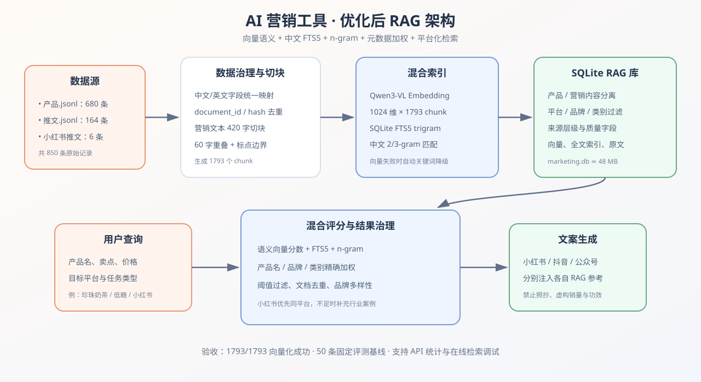

# RAG 优化实施报告

修订日期：2026-11-04。适用于当前合并版前端与现有后端。

> 分支迁移补充（2026-11-04）：本报告的 1793 个片段、已保存向量及标注文档存在性，来自
> 2026-11-03 对原工作目录数据库的只读核对。此次迁入仓库的是代码、三份 JSONL、测试集和历史结果，
> 不包含 SQLite 数据库或 `.env`。新克隆目录须先初始化索引，不能把下述原目录统计视为新目录已完成建库。

## 阅读说明与本次核对结论

本报告保留原 RAG 优化设计及历史评测基线，补充前端合并后的实际调用链。
本次只核对源代码、现有测试文件和只读数据库统计，没有运行检索评测、重建索引或调用模型，
也没有修改测试脚本、测试集、历史结果和密钥配置。

| 项目 | 本次确认的情况 |
|---|---|
| RAG 评测代码 | `backend/scripts/evaluate_rag.py` 仍在 |
| 固定测试集 | `backend/eval/rag_queries.jsonl` 仍在，50 条：46 条正例、4 条负例 |
| 历史结果 | `backend/eval/rag_report.json` 仍在，44/50 通过，88% 是历史基线 |
| 标注文档 | 11 月 3 日核对时，46 条正例引用的文档 ID 均存在于原工作目录索引 |
| 原工作目录索引 | 11 月 3 日核对为 1793 个片段、848 个不同文档 ID，1793 个片段均保存了向量；新仓库未复制该数据库 |
| 在线 Embedding 状态 | 由当前进程配置决定；上次文件检查 Key 已清空，不应再把历史 `embedding_enabled: true` 当作当前运行结论 |
| 旧网页 | 已清理；兼容旧 API 仍保留，默认网页使用 v2 接口 |

“已经保存了向量”和“当前能调用查询 Embedding”是两个状态。未提供 Embedding Key 或模型配置时，
查询使用本地 FTS5、n-gram 和元数据评分；数据库中的已有向量不会因为清空 Key 自动消失。
若是在服务运行期间清空 Key，需要重启服务使新配置生效；本次没有检查运行中进程的环境。

## 优化目标

建立一条可以检查、降级、评测和持续更新的完整 RAG 链路：

```text
JSONL 数据
  → 字段规范化
  → 语义切块
  → 去重与元数据保留
  → Embedding + 中文全文索引
  → 混合评分
  → 平台过滤与结果治理
  ├─ 营销案例 RAG → 按平台注入文案 Prompt
  └─ 产品事实 RAG → 注入生图 Prompt 与文案 Prompt
```



---


## 优化前的问题（历史背景）

原版 RAG 主要依赖向量遍历排序。

旧版流程：

```text
查询文本 → Embedding → 读取全部向量 → 余弦相似度 → Top 3
```

主要问题：

- Embedding API 失败时静默返回空结果；
- 没有中文关键词检索；
- 没有产品名称精确加权；
- 产品和营销案例可能混在一起；
- 没有平台、来源、类别过滤；
- 没有相关性阈值与去重；
- 三个平台共用同一组参考案例。


## 模型配置与当前降级方式

文字、图片、Embedding 使用各自的服务配置。不能仅凭已有文字 Key 判断其是否支持 Embedding；
旧报告记录的账户可用模型属于历史信息，本次没有查询供应商模型列表或验证账户权限。

Embedding 配置示意（不包含密钥）：

```env
EMBED_BASE_URL=
EMBED_API_KEY=
EMBED_MODEL=
EMBED_DIMENSIONS=1024
```

代码同时兼容 `EMBEDDING_API_KEY` 别名。只有 Key 与模型名均非空，才允许调用远程查询 Embedding。
未配置或调用失败时，RAG 可以降级为本地检索；文字/生图是否使用演示结果则由各自后端配置判断。

历史索引中保存的向量模型名为 `Qwen/Qwen3-VL-Embedding-8B`，这是已有数据库记录，
不是本次对模型可用性、权限或供应商端点的重新验证。

---

## 数据规模与索引现状

本次纳入三份数据：

| 数据文件 | 原始记录 | 用途 |
|---|---:|---|
| `产品.jsonl` | 680 | 产品名称、品牌、价格、规格、热量等事实检索 |
| `推文.jsonl` | 164 | 行业报道、品牌上新、宽口径营销案例 |
| `小红书推文.jsonl` | 6 | 小红书标题、正文语气、标签与种草结构 |
| 合计 | 850 | 产品事实 + 营销知识 |

原优化阶段完成规范化与重新切块后的历史快照如下。片段数与类型数本次已通过只读 SQL 核对一致，
但其中 `embedding_enabled: true` 仅记录历史配置状态：

```json
{
  "total_chunks": 1793,
  "embedded_chunks": 1793,
  "keyword_only_chunks": 0,
  "embedding_enabled": true,
  "by_type": {
    "product": 678,
    "broad_marketing_content": 1109,
    "marketing": 6
  }
}
```

---


## 核心实现与字段规范化

RAG 核心代码位于：

```text
backend/app/rag.py
backend/scripts/update_marketing.py
```

兼容中文和英文字段

```python
brand = _first(data, "brand", "品牌", "商家", "商家名称")
platform = _first(data, "platform", "平台")
product_name = _first(data, "product_name", "产品名称")
category = _first(data, "category", "产品类别", "分类")
title = _first(data, "title", "标题", default=product_name)
source_url = _first(data, "source_url", "来源链接")
```

这样既兼容项目现有 JSONL，也兼容旧版英文结构和后续新增数据。

自动判断记录类型

```python
def _infer_record_type(data):
    metadata = data.get("rag_metadata") or {}
    if metadata.get("record_type"):
        return metadata["record_type"]
    if data.get("product_id") or (data.get("产品名称") and data.get("价格")):
        return "product"
    if data.get("平台") == "小红书" or data.get("example_id"):
        return "marketing"
    if data.get("content_id") or data.get("正文"):
        return "broad_marketing_content"
    return "marketing"
```

检索时可以严格分离：

```text
product                    产品事实
marketing                  平台营销案例
broad_marketing_content    行业报道和宽口径营销内容
```

文档 ID 与内容哈希去重

优先使用数据自带 ID：

```python
identifier = _first(
    data,
    "product_id",
    "content_id",
    "example_id",
    "document_id",
)
```

没有 ID 时使用 SHA-256：

```python
content_hash = hashlib.sha256(content.encode("utf-8")).hexdigest()
document_id = identifier or content_hash[:24]
```

数据库唯一约束：

```sql
UNIQUE(document_id, chunk_id)
```

增量更新时相同文档会覆盖，不会无限产生重复记录。

---

## 切块策略优化

产品数据

产品数据保持“一条产品一个 chunk”，并重构为更稳定的事实格式：

```text
品牌：瑞幸；
产品：陨石拿铁；
类别：咖啡；
价格：¥32；
规格：450-596ml；
热量：200-250 kcal；
产品信息：……
```


营销内容

营销内容采用：

```text
目标长度：420 字
重叠长度：60 字
边界：优先句号、问号、感叹号、分号和换行
```

核心实现：

```python
def _chunk_text(text, target=420, overlap=60):
    ...
```

每个 chunk 还会附加元数据前缀：

```text
平台：小红书；品牌：瑞幸；产品：拿铁；标题：秋季新品
正文内容……
```

---
## 数据库结构

新版表 `rag_chunks`：

```sql
CREATE TABLE rag_chunks (
    id INTEGER PRIMARY KEY AUTOINCREMENT,
    document_id TEXT NOT NULL,
    chunk_id INTEGER NOT NULL,
    record_type TEXT NOT NULL,
    platform TEXT,
    brand TEXT,
    product_name TEXT,
    category TEXT,
    title TEXT,
    text TEXT NOT NULL,
    source_url TEXT,
    source_domain TEXT,
    source_tier TEXT,
    strict_eligible INTEGER,
    content_hash TEXT,
    embedding_model TEXT,
    vec TEXT,
    UNIQUE(document_id, chunk_id)
);
```

同时创建中文 trigram FTS5 索引：

```sql
CREATE VIRTUAL TABLE rag_chunks_fts USING fts5(
    title,
    brand,
    product_name,
    text,
    content='rag_chunks',
    content_rowid='id',
    tokenize='trigram'
);
```

插入、删除、更新触发器会自动同步全文索引。

---

## Embedding 接入与历史建库结果

独立配置

为避免把 Embedding Key 发到文字接口，新增独立配置：

```python
EMBED_BASE_URL = os.getenv("EMBED_BASE_URL") or QWEN_BASE_URL
EMBED_API_KEY = (
    os.getenv("EMBED_API_KEY")
    or os.getenv("EMBEDDING_API_KEY", "")
)
EMBED_MODEL = os.getenv("EMBED_MODEL", "")
EMBED_DIMENSIONS = int(os.getenv("EMBED_DIMENSIONS", "1024"))
```

兼容用户已经填写的 `EMBEDDING_API_KEY`，不要求重新移动密钥。

批量向量化

```python
response = client.embeddings.create(
    model=EMBED_MODEL,
    input=texts,
    dimensions=EMBED_DIMENSIONS,
    encoding_format="float",
)
```

- 每批默认 16 个 chunk；
- 输出 1024 维向量；
- 失败批次记录日志；
- 即使 Embedding 失败，FTS5 索引仍可使用；
- 查询向量使用 LRU 缓存，减少重复请求。

历史建库记录（本次未重新向量化）

```text
模型：Qwen/Qwen3-VL-Embedding-8B
向量维度：1024
需要向量化：1793
成功：1793
失败：0
数据库大小：约 48 MB
```

---

## 混合检索与评分

计算四类相关性信号，并额外加入来源质量分：

```text
1. vector_score   Embedding 语义相似度
2. fts_score      SQLite FTS5 全文召回排名
3. lexical_score  中文二元组/三元组字符重合度
4. metadata_score 产品名、品牌、类别匹配度
```

营销内容评分
```python
final_score = (
    0.50 * vector_score
    + 0.24 * lexical_score
    + 0.14 * fts_score
    + 0.07 * metadata_score
    + 0.05 * quality_score
)
```

营销检索偏重语义相似度，同时保留关键词、来源质量和元数据影响。

产品评分

```python
final_score = (
    0.30 * vector_score
    + 0.30 * lexical_score
    + 0.20 * fts_score
    + 0.15 * metadata_score
    + 0.05 * quality_score
)
```

产品检索更重视精确名称和全文命中，避免“语义相近但产品不对”。

无可用查询向量时使用以下权重，不会继续套用上述向量权重：

```python
final_score = 0.58 * lexical_score + 0.27 * fts_score + 0.10 * metadata_score + 0.05 * quality_score
```

FTS5 当前提供全文命中排名信号；实现仍会读取类型/平台过滤后的片段并遍历评分，
尚未改成向量数据库的近似索引召回，也未实现独立 Reranker。


结果输出前还会执行：

```text
最低分数过滤
同 document_id 去重
营销结果同品牌最多两条
产品结果不限制品牌数量
平台案例优先
宽口径案例不足时补齐
```

---

## Reranker 精排草案（尚未接入、未实测）

当前混合检索负责从 1793 个 chunk 中召回候选。下一阶段不会让 Reranker 扫描全库，而是采用“两阶段检索”：

```text
1793 个 chunk
  → Embedding + FTS5 + n-gram 混合召回 Top 20
  → Qwen/Qwen3-VL-Reranker-8B 精排
  → 最终 Top 3～5
  → 注入文案 Prompt
```

未来配置草案如下；当前程序没有读取这些配置，写入 `.env` 不会启用精排。
模型名与端点沿用原设计示意，接入前需另行确认供应商实际接口和权限：

```env
RERANK_BASE_URL=https://api.siliconflow.cn/v1
RERANK_API_KEY=<可复用 Embedding Key>
RERANK_MODEL=Qwen/Qwen3-VL-Reranker-8B
RERANK_CANDIDATES=20
RERANK_ENABLED=true
```

核心请求结构：

```python
response = requests.post(
    f"{RERANK_BASE_URL.rstrip('/')}/rerank",
    headers={
        "Authorization": f"Bearer {RERANK_API_KEY}",
        "Content-Type": "application/json",
    },
    json={
        "model": RERANK_MODEL,
        "query": query,
        "documents": [item["text"] for item in candidates],
        "top_n": top_k,
        "return_documents": False,
    },
    timeout=30,
)
```

根据响应中的 `index` 和 `relevance_score` 重排原候选：

```python
results = []
for result in response.json()["results"]:
    item = dict(candidates[result["index"]])
    item["rerank_score"] = result["relevance_score"]
    results.append(item)
```

接入时必须保留降级路径：

```python
try:
    return rerank(query, candidates, top_k)
except Exception:
    logger.exception("Reranker 失败，使用原始混合排序")
    return candidates[:top_k]
```

Reranker 主要优化 Top 1 与 MRR，不能修复“相关文档根本没有进入候选集”的问题。因此应先用 `Recall@20` 确认初召回，再判断失败用例属于召回问题还是排序问题。

---


## 营销案例的按平台检索

最初版本的三个平台共用同一组参考：

```python
references = rag.search_marketing(query, top_k=3)
```

新版按平台分别检索：

```python
references = rag.search_for_platforms(
    query,
    ["小红书", "抖音", "公众号"],
    top_k=3,
)
```

结果结构：

```json
{
  "小红书": ["小红书案例..."],
  "抖音": ["抖音或行业案例..."],
  "公众号": ["公众号或行业案例..."]
}
```

兼容旧文案 provider 的 Prompt 会标记参考类型；当前 v2 的结构见下一节：

```text
参照 1（风格案例；小红书 / 标题）
……

参照 2（行业事实案例；喜茶 / 新品上新）
……
```

并明确约束：

```text
不得照抄；不得虚构案例中的销量或功效。
```

---

## 当前合并版的调用链与产品资料使用

### 页面与接口

```text
营销创作页：模糊搜索产品（输入一个字即可联想）
  → POST /api/v2/products/search，semantic=false
  → 复用原 /api/search：SQL 模糊匹配 + 本地产品 RAG
  → 显示候选；点击后加入当前品牌并自动勾选

开始生成文案
  → POST /api/v2/copywriting
  → backend/app/providers/campaign.py
      ├─ 选定商品资料 + 匹配的产品事实 → 文案 Prompt
      └─ 按平台检索营销案例 → 文案 Prompt
  → 返回标题、正文、摘要、话题和参考案例来源

按需生成图片
  → POST /api/v2/images
  → backend/app/v2.py
  → 对应商品信息 + 可选的产品上下文 + 海报解析 + 营销需求 → 图片 Prompt
  → 当前生图 provider
```

“一个字触发”是前端行为：当前品牌本地产品与 SQL 可以立即匹配；原 `/api/search` 只有在输入
至少两个字符时才补充产品 RAG 结果。输入联想使用本地检索，不调用远程查询 Embedding。
产品库弹窗也保留名称联想与单独的知识库检索入口。

勾选语义搜索时，v2 接口使用 `semantic=true` 调用现有产品语义检索；只有配置有效且库中有向量，
才会发出查询 Embedding 请求。配置缺失或请求失败会降级，并不能仅凭返回候选断定已使用语义向量。

### 产品库与营销案例库各自的作用

| 来源 | 提供什么 | 使用条件 |
|---|---|---|
| 页面选定的商品资料 | 本次产品名称、用户确认的价格、卖点 | 随本次请求直接提供 |
| 产品 RAG，`record_type=product` | 核验标准商品名称、品牌、类别、规格等事实 | 先做唯一性与置信度判断；v2 额外检查非空品牌是否与当前品牌一致 |
| 营销 RAG，`marketing` / `broad_marketing_content` | 结构、语气与表达参考 | 先同平台，不足再从更广的营销资料补齐；不限定当前品牌 |

产品库的主要生成用途是补充 Prompt 中的商品事实，同时支撑前面的搜索与填入。
不会把整份产品库或全部营销案例直接交给模型。示例商品未在真实产品库命中时，
仍可按用户在页面确认的商品资料生成，生成成功本身不代表产品 RAG 命中。

文案侧为每款商品解析产品上下文；返回 `None` 或遇到品牌冲突时不注入该条核验资料。
图片侧按 `product_ids` 选择对应商品，只有单个商品时额外解析产品上下文；多商品合图使用本次提交的商品信息。
当前实现不会把页面的品牌单独传入底层唯一产品解析器来消除所有同名歧义，
即使页面已选品牌，底层解析出 `None` 时也不会强行选取某条记录。

### 营销案例的数量与可见性

- 每个产品分组、每个平台最多取 3 条案例，每条最多取 500 个字符加入 v2 文案 Prompt。
- 平台不足时允许跨平台/未标注营销资料补充；当前不是只限严格精选资料的过滤模式。
- 案例用于结构与风格，Prompt 要求不得套用案例商品事实，价格以用户本次填写为准。
- 当前 v2 在 Prompt 中使用案例片段及平台字段；旧 provider 的“风格案例/行业事实案例”文字标签不能直接当成 v2 的实际格式。
- 前端“参考案例来源”展示文档 ID、标题和平台；当前 v2 未返回完整 `product_context` 或产品命中状态供页面展示。
- 因此“参考案例来源”显示的是营销案例，不是本次所有产品检索命中的清单。
- 图片不直接复用 RAG 中的案例图片；图片 Prompt 使用商品信息、可选参考海报解析和内容主题。

### 仍保留的调试 API

| 接口 | 用途 |
|---|---|
| `GET /api/rag_stats` | 索引规模、类型、平台与当前进程的 Embedding 配置状态 |
| `GET /api/rag_search?kind=product&q=...&top_k=3` | 产品 RAG 调试 |
| `GET /api/rag_search?platform=小红书&q=...&top_k=3` | 按平台检索营销案例 |
| `GET /api/search?q=...` | SQL + 本地产品 RAG 联想 |
| `GET /api/product_search?q=...&top_k=5` | 按当前配置尝试语义产品检索，无法使用向量时降级 |

旧的 `/api/generate`、`/api/image`、`/api/copywriting` 等 API 继续保留。
这些旧生成接口仍返回 `product_context`，可用于调试原链路；不能据此声称当前 v2 页面也展示该字段。
合并后的默认页面使用 v2；旧网页和 `/legacy/` 挂载已按要求删除。

当前 v2 文案生成与生图分别请求，不保证两次请求的检索上下文是同一个内存对象或同一份快照。
需要审计“本次具体命中了哪条产品记录”时，可作为后续功能给 v2 增加产品来源元数据；本次仅修正文档，没有添加该能力。

---

## 重建与更新操作

以下以你电脑已安装的 Python 3.11 为例，使用与项目启动相同、且已安装依赖的解释器。
如果平时使用虚拟环境，把 `python3.11` 替换为对应环境的 Python 路径。

原工作目录的已有索引无需因为合并前端或清理旧目录而重建；新克隆目录未复制数据库，需要首次建库。
不带 `--append` 会清空并重新构建当前 `rag_chunks`；没有 Embedding 配置时不会保留旧向量，
重建出来的是本地关键词索引。只想运行评测时，不要先执行全量重建。

确需全量重建时：

```sh
cd "/Users/wenzhang/Desktop/ai-marketing-tool/backend"
python3.11 scripts/update_marketing.py
```

默认读取 `backend/data/产品.jsonl`、`推文.jsonl`、`小红书推文.jsonl`。

增量追加其他目录：

```sh
cd "/Users/wenzhang/Desktop/ai-marketing-tool/backend"
python3.11 scripts/update_marketing.py ../marketing --append
```

配置有效时，更新会调用 Embedding 服务；未配置时仅创建本地索引。
追加也可能覆盖同一文档的原记录，需按实际更新目的使用，不是查看效果所必需的步骤。

---

## 回归评测：代码、测试集与历史结果均已保留

| 文件 | 本次确认 | 用途 |
|---|---|---|
| `backend/scripts/evaluate_rag.py` | 存在，未修改 | 调用 RAG 检索函数，计算指标和逐条结果 |
| `backend/eval/rag_queries.jsonl` | 存在，50 条，未修改 | 固定查询、相关文档 ID、关键词与负例阈值 |
| `backend/eval/rag_report.json` | 存在，未覆盖 | 历史评测结果、失败用例、索引快照和延迟 |

清理时保留了整个 `backend/scripts` 与 `backend/eval`。此次又逐项确认文件存在，
读取测试集和结果 JSON，并只读确认标注文档仍在数据库中；没有执行该评测脚本。

此脚本直接评测 RAG 检索，不需要启动网页或 Uvicorn。它不评测生成文案/图片的质量，
不调用文案或生图模型；若提供了有效 Embedding 配置，检索时可能调用查询 Embedding。

推荐将新的结果另存，保留原基线：

```sh
cd "/Users/wenzhang/Desktop/ai-marketing-tool/backend"
python3.11 scripts/evaluate_rag.py --top-k 10 --workers 4 --output eval/rag_report_current.json
```

Key 未配置时，此命令测到的是本地降级检索效果。若要与原向量混合基线做同条件对比，
需记录并对齐数据、Embedding 模型/维度、是否实际使用向量、查询缓存及并发设置。
脚本沿用已有逻辑，未在本次新增这些实验条件的自动记录能力。

退出码为 1 可能表示指标未达到阈值；应查看 JSON 中 `threshold_passed` 和逐条 `error`，
不能仅凭退出码就认定程序崩溃。

固定标注集位于 `backend/eval/rag_queries.jsonl`，共 50 条：

| 分组 | 数量 | 历史通过 | 历史通过率 |
|---|---:|---:|---:|
| 产品精确 | 20 | 20 | 100% |
| 产品易混淆 | 10 | 5 | 50% |
| 营销案例 | 10 | 9 | 90% |
| 小红书平台 | 6 | 6 | 100% |
| 跨领域负例 | 4 | 4 | 100% |

其中 46 条正例绑定真实 `document_id`；4 条跨领域负例没有相关文档 ID，按最高结果分数阈值判断拒绝效果。
本次静态核对未发现测试集中引用的文档 ID 缺失。评测范围包括：

```text
7 个主要品牌
产品精确名称与价格/热量条件
同品牌、同品类易混淆产品
品牌联名、上新、季节营销案例
全部 6 条小红书平台案例
汽车、编程、航天、数学等跨领域负例
```

历史完整基线结果（来自已有 `rag_report.json`，本次未重新运行）：

```text
总用例：50
通过：44
通过率：88.00%
Hit@1：78.26%
Recall@5：85.87%
MRR@10：82.96%
平台准确率：100%
负例拒绝率：100%
P50 延迟：3192.2ms
P95 延迟：5531.7ms
```

指标口径：Hit@1、Recall@5、MRR 使用 46 条正例计算；通过率使用全部 50 条。
正例通过还要求相关文档进入前五、必需词出现在前五结果组合文本中、指定平台的首条结果平台匹配。
平台准确率目前仅统计 ID 以 `xiaohongshu_` 开头的 6 条正例，不代表抖音和公众号也已完成相同评测。
MRR 字段虽名为 `mrr_at_10`，实现按实际 `--top-k` 返回范围计算，复现实验时应固定 `--top-k 10`。

指标定义与历史结果：

| 指标 | 含义 | 历史基线值 | 目标值 | 历史状态 |
|---|---|---:|---:|---|
| Hit@1 | 第一条就是相关文档的比例 | 78.26% | ≥80% | 未达标 |
| Recall@5 | 前五条覆盖标注相关文档的比例 | 85.87% | ≥90% | 未达标 |
| MRR@10 | 第一个相关结果排名的倒数均值 | 82.96% | ≥80% | 达标 |
| 平台准确率 | 6 条小红书正例的 Top 1 平台正确率 | 100% | ≥95% | 达标 |
| 负例拒绝率 | 跨领域查询得分低于阈值的比例 | 100% | ≥75% | 达标 |

评测命令：

```sh
cd "/Users/wenzhang/Desktop/ai-marketing-tool/backend"
python3.11 scripts/evaluate_rag.py --top-k 10 --workers 4 --output eval/rag_report_current.json
```

历史运行未通过的 6 条及当时的问题分析如下。当前代码已经包含部分品牌过滤、别名与数值映射；
此表不代表这些用例现在仍失败，也不代表已经修复通过，需要新一轮评测确认：

| 用例 | 相关文档首次排名 | 主要问题 |
|---|---:|---|
| 星巴克零热量冷咖啡 | 未进入 Top 10 | “零热量”与 `0 kcal` 缺少数值同义映射 |
| 生椰拿铁 瑞幸 首创 | 第 6 | 同名产品多，品牌约束权重不足 |
| 奈雪十九元橙子茶 | 第 10 | 中文数字与 `¥19`、产品别名匹配不足 |
| 霸王茶姬经典伯牙茶饮 | 第 6 | “经典伯牙”与“伯牙绝弦”别名关系不足 |
| 库迪桂花咖啡 252卡 | 第 7 | “桂花”与“金桂”、`252卡` 与 `252 kcal` 归一化不足 |
| 星巴克无糖太妃榛果拿铁新品 | 未进入 Top 10 | 长文档切块及候选多样性导致目标文档漏召回 |

由此可将优化分为两类：

```text
召回问题：别名词典、品牌硬过滤、数值归一化、提高候选数
排序问题：接入 Reranker，将已召回的正确文档提升到 Top 1
```

历史机器可读报告保存在 `backend/eval/rag_report.json`。本次保留原有数值，没有把 88% 通过率、
100% 小红书平台准确率或历史延迟冒充为合并后的新测结果，也没有新增未测得的提升幅度。
新一轮结果应另存，并标明本地检索或向量混合模式后再比较。

---

## 实现与相关文件（历史优化及当前合并版）

| 文件 | 修改内容 |
|---|---|
| `backend/app/rag.py` | 重写 RAG 数据治理、索引、Embedding 和混合检索 |
| `backend/app/config.py` | 增加独立 Embedding 配置与 Key 别名兼容 |
| `backend/app/pipeline.py` | 解析一次产品上下文，并同时传给生图与文案链路；营销案例改为分平台检索 |
| `backend/app/providers/image.py` | 将核验后的品牌、标准产品名和类别加入生图提示词 |
| `backend/app/providers/copywriting.py` | 按平台注入结构化营销参考，并加入核验产品事实与价格冲突规则 |
| `backend/app/main.py` | 增加 RAG 状态、营销检索、产品联想与语义产品搜索接口 |
| `backend/scripts/update_marketing.py` | 重写数据加载、重建和增量更新流程 |
| `backend/scripts/evaluate_rag.py` | 新增检索回归评测 |
| `backend/eval/rag_queries.jsonl` | 50 条真实文档 ID 标注测试集 |
| `backend/eval/rag_report.json` | 完整评测指标、失败用例和逐条结果 |
| `backend/scripts/import_marketing.py` | 适配新版入库统计 |
| `backend/.env.example` | 增加 Embedding 配置示例 |
| `README.md` | 更新 RAG 使用与维护说明 |
| `frontend/index.html` | 当前前端入口，加载模块并显示服务配置状态 |
| `frontend/src/app.js` | 创作页单字模糊搜索、产品资料选择、参考来源展示与作品交互 |
| `frontend/src/services/api.js` | v2 请求及响应适配；默认同源调用后端 |
| `backend/app/v2.py` | 新版文案、图片、产品检索及改写路由，兼容当前业务能力 |
| `backend/app/providers/campaign.py` | 品牌营销文案、多产品/平台分组、品牌核对和 RAG Prompt 组织 |

---

## 仍存在的问题

1. 当前索引只有 6 个标注为小红书的案例片段；1787 个片段未标平台，抖音和公众号缺少专门标注的案例。
2. 独立 Reranker 仍未接入；相关章节是设计草案，不是已完成能力。
3. 历史基线有 6 条未通过，Hit@1、Recall@5 未达标；品牌过滤和部分别名规则虽已实现，尚无此次修改后的新评测结果。
4. 标注集仍为 50 条，平台专项评测仅覆盖小红书；最终文案/图片质量需要独立评测方案。
5. 新版 v2 未返回完整产品命中元数据，页面不能直接确认每条产品核验资料的命中情况。
6. 本次没有验证运行中进程的 Key/Embedding 状态。没有 Key 时可保留并检索本地资料，但不能把已有向量数量当作在线语义检索已启用的证据。

### 推荐下一步

```text
P0：保留现有历史基线，用同一 50 条标注集另存一份当前结果，记录是否启用查询 Embedding
P0：核对已实现的品牌过滤、别名/数值映射效果，针对当前仍失败的用例继续优化
P0：在初召回充分后再实施 Top 20 候选 + 独立 Reranker，并完成同条件 A/B 对比
P1：为 v2 增加产品命中来源/状态，改善事实使用的可检查性
P1：扩充 50～100 条高质量小红书案例
P1：补充抖音、公众号平台标签与真实案例
P3：数据超过一万 chunk 后迁移 sqlite-vec / FAISS / pgvector
```


## 本次文档修订范围

本次仅修正本报告：补充当前调用链、产品与营销资料职责、配置降级状态、Mac 命令、
历史/当前结果的边界，以及已保留的评测资产。原数据统计、评分设计和已有历史评测数值保留。
没有修改 RAG 代码、模型配置、数据库、评测脚本、测试集或历史结果；没有重新运行测试或调用模型。
